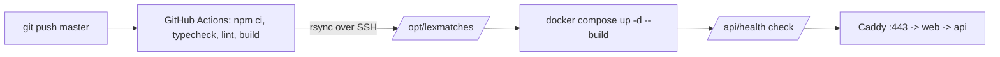

# Deploy to a server

Every push to `master` runs [.github/workflows/deploy.yml](../.github/workflows/deploy.yml): it type-checks,
lints and builds the frontend on GitHub, copies the repository to `/opt/lexmatches` on the server, and runs
[remote-deploy.sh](remote-deploy.sh) there, which rebuilds the Docker images that changed, restarts them and
checks `/api/health`. If the site does not answer, the job fails (red in GitHub).



The server keeps its own `/opt/lexmatches/.env` (domain, secrets, API keys); a deploy never touches it.
The database, uploaded books and cached audio live in Docker volumes and survive deploys.

## 1. One-time server setup (Ubuntu 24.04, as root)

```bash
scp deploy/server-setup.sh root@<server-ip>:/root/
ssh root@<server-ip> bash /root/server-setup.sh <domain>
```

It adds 2 GB of swap, installs Docker, opens ports 22/80/443, creates the `deploy` user (SSH key only, in
the `docker` group) and `/opt/lexmatches/.env` with fresh random secrets. Then add the API keys:

```bash
ssh root@<server-ip> nano /opt/lexmatches/.env       # ANTHROPIC_API_KEY, XAI_API_KEY
```

### Domain and Cloudflare

1. Cloudflare → your domain → DNS → Add record: type `A`, name e.g. `read` (or `@` for the bare domain),
   IPv4 = the server's IP, proxy status **DNS only** (grey cloud) for now.
2. On the server set `SITE_DOMAIN=<that name>` in `/opt/lexmatches/.env` and run `sh deploy/remote-deploy.sh`.
   Caddy fetches a Let's Encrypt certificate; `https://<domain>/api/health` must answer.
3. Optional, to put Cloudflare in front (hides the server's IP, absorbs attacks): SSL/TLS → Overview →
   **Full (strict)**, then switch the DNS record to **Proxied** (orange cloud). Never use "Flexible": it
   sends traffic to the server unencrypted and loops on redirects.

The visitor's IP in the analytics stays correct in both modes ([Caddyfile](Caddyfile) accepts Cloudflare's
visitor header only from Cloudflare's own addresses).

## 2. GitHub secrets

Repo → Settings → Environments → New environment `Prod` → add secrets:

| Secret | Value |
|---|---|
| `DROPLET_HOST` | server IP |
| `DROPLET_USER` | `deploy` |
| `DROPLET_SSH_KEY` | the private key the setup script created: `ssh root@<server-ip> cat /root/gh-deploy` |
| `DROPLET_KNOWN_HOSTS` | output of `ssh-keyscan -t ed25519 <server-ip>` |

After adding the key to GitHub, delete it from the server: `ssh root@<server-ip> rm /root/gh-deploy /root/gh-deploy.pub`.

## 3. Deploy

Push to `master`, or run it by hand: Actions → Deploy to server → Run workflow.
Changes to docs and tests alone do not trigger a deploy.

## Operations

```bash
ssh deploy@<server-ip>            # or root@
cd /opt/lexmatches
C="docker compose -f docker-compose.yml -f docker-compose.prod.yml"
$C ps                             # what is running
$C logs -f api                    # app log (web, caddy, postgres likewise)
sh deploy/remote-deploy.sh        # apply a .env change / redeploy what is on the server
cat REVISION                      # which commit is live
grep ADMIN_TOKEN .env             # admin page: https://<domain>/admin#<token>
```

Rollback: revert the commit and push, or re-run an older run of the workflow in GitHub Actions.

Backup: the volumes `lexmatches_pgdata` and `lexmatches_miniodata`, or the host's server snapshots.
`docker system df` shows disk use; the deploy removes unused image layers each time.
