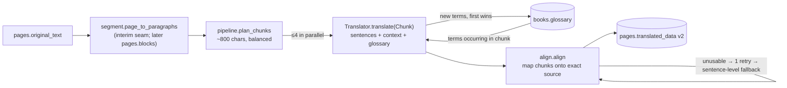

# Architecture

Read this first. Everything runs from `docker compose up` with four services.

```mermaid
flowchart LR
    B[Browser<br/>React SPA] -->|":3100 /"| W[web<br/>nginx + Vite build]
    W -->|"/api/* proxy"| A[api<br/>FastAPI, Python 3.12]
    A -->|psycopg| P[(postgres 17<br/>users, books, pages,<br/>reading_sessions)]
    A -->|S3 / boto3| M[(minio<br/>bucket "books":<br/>PDFs + per-user tts cache)]
    A -->|anthropic SDK| C[Claude API<br/>optional]
    A -->|local| T[Piper TTS<br/>voices volume]
    A -.->|optional| E[ElevenLabs / Stripe]
```

| Service | Image | Host port | Notes |
|---|---|---|---|
| `postgres` | postgres:17 | 5544 | volume `pgdata` |
| `minio` | cgr.dev/chainguard/minio (upstream `minio/minio` is no longer published) | 9200 S3, 9201 console | volume `miniodata`; bucket created by the api at startup |
| `api` | `backend/Dockerfile` | 8100 | runs migrations, ensures bucket, recovers jobs on startup |
| `web` | `web/Dockerfile` | 3100 | nginx serves `dist/`, proxies `/api` to `api:8000` |

## Backend layout (`backend/app`)

| Path | Domain |
|---|---|
| `main.py` | app + lifespan (migrate → ensure bucket → `jobs.recover()`) |
| `config.py` | all env settings (see `.env.example`) |
| `db.py`, `migrations/*.sql` | psycopg pool helpers; idempotent SQL migration runner (`schema_migrations`, advisory lock). Add `002_*.sql` for schema changes |
| `auth.py`, `routers/auth.py` | argon2 passwords, HS256 JWT bearer (`current_user` dependency) |
| `routers/common.py` | ownership checks (`owned_book`, `owned_page` → 404 for other users) and serializers |
| `jobs.py` | in-process thread-pool jobs keyed by `book:<id>` / `page:<id>`; status lives in Postgres |
| `services/extraction.py` | **PDF extraction** (PyMuPDF plain text per page) — extraction agent works here |
| `services/processing.py` | book job: download PDF → `extract_pages` → replace `pages` rows |
| `translation/` | **translation**: `base.py` (Translator protocol, `Chunk`), `segment.py` (interim page → sentences), `prompts.py`, `claude.py`, `mock.py`, `align.py` (deterministic chunk alignment), `pipeline.py` (chunking, context, glossary, resume, persistence) — see [Translation](#translation) |
| `tts/` | **TTS**: `__init__.py` (plan → cache → bounded synth pool, per-user cache, deletion, lifecycle, preload), `text.py` (normalisation), `piper.py` (voices, alignment, word timings), `audio.py` (MP3), `elevenlabs.py` |
| `services/export.py`, `export_template.html` | standalone interlinear HTML export |
| `routers/billing.py` | Stripe (off unless `STRIPE_SECRET_KEY`) |
| `routers/progress.py` | reading sessions + progress-page data |

See [Frontend](#frontend) below.

## Jobs and statuses

`books.status` and `pages.status`: `pending | processing | completed | failed` (+ `error` text).

- Upload (`POST /api/books`) stores the PDF at `books/<user_id>/<book_id>.pdf`, creates the book
  `pending`, queues `process_book`. Text books (`POST /api/books/text`) are `completed` with one page.
- Translate (`POST /api/pages/{id}/translate`) marks the page `processing`, queues `translate_page`
  and returns 202; clients poll `GET /api/pages/{id}` (`progress.done/total`). Idempotent.
- On API start: pages stuck in `processing` → `pending`; pdf books in `pending/processing` are re-queued.
  Single api instance assumed (job dedupe is in-process).

## Database schema (`migrations/001_init.sql`)

- `users(id, email unique ci, password_hash, full_name, pages_translated_free, daily_translations_count, last_translation_date, created_at, updated_at)`
- `books(id, user_id→users, title, original_locale, target_locale, source 'pdf'|'text', status, error, total_pages, last_read_page, glossary jsonb (002), created_at, updated_at)`
- `pages(id, book_id→books, page_number, original_text, blocks jsonb NULL, translated_data jsonb, images jsonb, status, error, created_at, updated_at, UNIQUE(book_id, page_number))`
- `reading_sessions(id, user_id, book_id, page_number, translation_toggle_clicks, session_date, UNIQUE(user_id, book_id, page_number, session_date))`

Locales are stored as the UI sends them (`"french"`, `"english"`, …); `app/languages.py` maps to ISO codes.

## Page data contract

| Field | Producer | Contract |
|---|---|---|
| `page_number` | extraction | 1-based **PDF page index**; every PDF page gets a row (even if text is empty) so text view and PDF view stay aligned |
| `original_text` | extraction | plain text; `\n` separates lines. **Translation units = sentences**, from `translation/segment.py::page_to_paragraphs` (joins hard-wrapped lines into paragraphs, splits sentences) |
| `blocks` | extraction (future) | reserved, currently `NULL`. Intended for structured output (paragraphs, headings, footnotes, header/footer flags, reading order). When it exists, `page_to_paragraphs` is the one function to switch over to it |
| `translated_data` | translation | v2, see [Translation data contract](#translation-data-contract-v2). Legacy v1 pages (`lines` per visual line, no `version`) stay readable |
| `images` | — | `[]` (legacy column, unused) |

Pages API responses add `progress: {done, total}` (computed).

## API

All endpoints except signup/login/health need `Authorization: Bearer <token>`. Errors: `{"detail": …}`.
Other users' books/pages answer 404.

| Method | Path | Purpose |
|---|---|---|
| GET | `/api/health` | liveness + active translator |
| POST | `/api/auth/signup`, `/api/auth/login` | `{email, password}` → `{token, user}` |
| GET | `/api/auth/me` | current user |
| GET | `/api/books` | list own books |
| POST | `/api/books` | multipart `title, original_locale, target_locale, file` → book (`pending`) |
| POST | `/api/books/text` | `{title, original_locale, target_locale, text}` → book with 1 page |
| GET / PATCH / DELETE | `/api/books/{id}` | get; patch `{last_read_page?, title?}`; delete (+PDF) |
| GET | `/api/books/{id}/pdf` | original PDF bytes |
| GET | `/api/books/{id}/pages?numbers=1,2&status=` | pages (ordered) |
| GET | `/api/books/{id}/stats` | `{translated, total}` |
| GET | `/api/books/{id}/search?q=` | `[{pageNumber, snippet, matchCount}]` |
| POST | `/api/books/{id}/reset-failed` | failed pages → pending |
| POST | `/api/books/{id}/export` | `{pageNumbers}` → `text/html` attachment |
| GET | `/api/pages/{id}` | one page |
| POST | `/api/pages/{id}/translate` | start/resume translation (202) |
| POST | `/api/reading-sessions` | upsert `{book_id, page_number, translation_toggle_clicks, session_date?}` |
| GET | `/api/progress` | `{books, sessions[{…, words}]}` for the progress page |
| POST | `/api/tts` | `{text ≤2000, language?, book_id?, voice?, provider?}` → `{audio_url, duration, words, voice, provider, cached, content_type}`; 404 no server voice, 400 nothing speakable, 503 + `Retry-After` voice downloading / busy, 429 rate limit |
| GET | `/api/tts/audio/{book_id\|misc}/{sha}.mp3` | the clip (own clips only), `Cache-Control: private, max-age=31536000, immutable`, ETag |
| POST | `/api/tts/prepare` | `{language}` → `{voice, state: ready\|loading\|downloading\|missing\|error\|unavailable, progress?}`; starts download/load in background |
| GET | `/api/subscription` | billing off → `{billing_enabled:false, subscribed:true, unlimited:true}` |
| POST | `/api/billing/checkout`, `/api/billing/portal` | Stripe URLs (404 when billing off) |

## Translation

`get_translator()` returns `ClaudeTranslator` when `ANTHROPIC_API_KEY` is set (or `TRANSLATOR=claude`),
else `MockTranslator`. Tests inject translators with `translation.set_translator()`.



| File | Role |
|---|---|
| `segment.py` | **interim** `page_to_paragraphs(text) -> list[list[str]]`: joins hard-wrapped lines (blank line / short line ending a sentence / dialogue dash = new paragraph), drops typesetter hyphenation (U+00AD, U+2010), regex sentence split with an abbreviation guard, CJK split on 。！？, caps sentences at 500 chars. Replace its body with a `pages.blocks` reader when extraction delivers blocks |
| `prompts.py` | the system prompt (~150 words, per language pair, first in the request for caching), the user message (glossary, preceding text + its translation, numbered sentences) and the fixed JSON schema `{"s": [{"t", "u": [[chunk, gloss]]}], "g": [[term, rendering]]}` |
| `claude.py` | one `messages.create` per chunk: structured output, `output_config.effort` (`ANTHROPIC_EFFORT`, default `low`), model `ANTHROPIC_MODEL` (default `claude-opus-5-5`; `claude-sonnet-5-5` is half the cost with similar judged quality on French but weaker translations elsewhere; `claude-haiku-5-5` misaligns glosses — not recommended), refusal fallback (`fallbacks: "default"` on supported models; `ANTHROPIC_FALLBACKS=off`), errors mapped to `TranslatorError` / `RateLimited` |
| `align.py` | deterministic safety net: chunk boundaries are mapped onto the real sentence (char diff when the echo differs), so `original`s are always exact source slices covering the sentence in order; punctuation-only chunks merge into neighbours; `repaired` flag when the echo differed |
| `pipeline.py` | chunking, context, glossary relevance/merge (`books.glossary`, cap 300, ≤40 injected, never rewrites an entry), one retry for unusable sentences then sentence-level fallback, rate-limit backoff, positional persistence after every chunk (resume), daily counter |

Context and consistency: each chunk sees the preceding ~600 source chars (with their translation when already
known: earlier chunks on resume, or the previous page) and the glossary entries whose words occur in the chunk.
Every response reports new proper nouns/terms; they are merged into `books.glossary` under a row lock, existing
entries win, so pages translated in parallel or out of order converge on the first decision. While a book's
glossary is still empty, the first chunk of a page runs alone before the others (seeds the glossary).

### Translation data contract (v2)

`pages.translated_data`, written after every finished chunk (frontend contract; index-aligned arrays, one entry
per **sentence**):

```json
{
  "version": 2,
  "lines": [[{"original": "Il y avait", "translation": "there was"}, {"original": "en Vestphalie,", "translation": "in Westphalia,"}], null],
  "sentences": [{"source": "Il y avait en Vestphalie, …", "translation": "There was once, in Westphalia, …", "paragraph": 0, "repaired": true}, null],
  "fullTranslation": "There was once, in Westphalia, …\n\nNext paragraph …"
}
```

- `lines[i]`: learner chunks of sentence `i` (1–3 words typically, punctuation attached). `original`s are exact
  substrings of `sentences[i].source`, in order; joined with the source whitespace (a space for spaced scripts,
  nothing for Japanese/Chinese) they reproduce the sentence. `translation` is a literal, context-aware gloss.
- `sentences[i]`: `source` sentence, natural `translation`, `paragraph` index on the page (group sentences with
  the same value into one paragraph), `repaired: true` only when the model's chunks had to be re-aligned or the
  sentence fell back to one sentence-level chunk (show it normally; it is a quality signal, not an error).
- `null` at `i` in both arrays = not translated yet (resume point; `progress.done/total` counts sentences).
- `fullTranslation`: natural translations; sentences joined by a space, paragraphs by `\n\n`.
- Legacy v1 (no `version`): `lines[i]` = pairs for the i-th non-empty visual line, `fullTranslation` = glosses
  joined. Completed v1 pages are not retranslated; unfinished ones restart as v2.

Evaluation: `backend/eval/` (see `eval/run.py` docstring) runs the old and new pipelines and candidate models on
15 fixed passages (fr/de/ru/pt/lv/ja→en, en→lv, fr→ru; `eval/passages/`) against the real API (responses cached
in `eval/cache/`, so reruns are free) and reports deterministic metrics, cross-page consistency and a blind
Claude Fable 5.1 judge. Last run (Opus 5.5, effort low): old vs new judged 0/15 vs 15/15 (translation 3.0→8.8,
glosses 6.7→7.9, chunking 4.9→7.9); exact source reproduction 100%, no retries; $0.067/page (old $0.122);
page latency p50 17.7 s / p95 23 s (old 12.2 / 31.5).

## TTS (read aloud)

Backend `app/tts/`, endpoint `routers/tts.py`, frontend module `src/features/audio/`.

```mermaid
sequenceDiagram
    participant R as ReadingView (segments)
    participant C as features/audio controller
    participant A as api /api/tts
    participant S as MinIO tts/<user>/<book>/
    participant P as Piper pool (TTS_WORKERS)
    R->>C: useReadAloud({segments, bookId, onQueueEnd})
    C->>A: POST /tts/prepare {language} (on mount: download / load voice in background)
    C->>A: POST /tts {text: part, language, book_id}
    A->>S: <sha>.json cached?
    alt miss
        A->>P: synthesize (identical requests coalesced)
        P-->>A: mp3 + per-token [start, end]
        A->>S: <sha>.mp3, then <sha>.json
    end
    A-->>C: {audio_url, duration, words}
    C->>A: GET audio_url (blob, immutable)
    C->>C: play in one <audio>; prefetch next 2 parts; rAF -> activeWord
    C-->>R: activeId / wordFor(id); end of list -> onQueueEnd() (next page)
```

**Request unit.** The client splits each segment (a sentence in the reader)
into *parts*: a part ends at the first sentence end after 160 characters (`controller.ts::splitSegment`).
One part = one request (server limit 2000 chars). Short lines are one part. Back / forward / "say
again" act on parts, i.e. sentences in long paragraphs.

**Normalisation** (`text.py`, token by token so timings map back to display tokens): footnote markers
(`[12]`, `¹`, `*`, `mot(3)`), quotes/guillemets, dialogue dashes (dropped at segment/sentence start,
a pause elsewhere), apostrophes, and per-language abbreviations whose period espeak would treat as a
sentence end (`M.` → Monsieur, `Mr.` → Mister, `z.B.`, `т.е.`, …). Numbers are left to espeak-ng, which
reads them per language. Punctuation-only text → 400.

**Word timings** (`piper.py`). piper-tts 1.8 can return per-phoneme sample counts when the ONNX
model exposes its duration tensor; each voice is patched once on disk after download
(`piper.patch_voice_with_alignment`, needs the `onnx` package, +31 MB image). These are the durations
the model itself used to generate the audio, so they are exact to one hop (256 samples ≈ 11.6 ms).
Each spoken unit is phonemized alone and its phones are aligned to the in-context phone sequence with
`difflib`; context effects (espeak merging "of the", liaison, stress shifts) only touch the phones
involved. Sentences are separated by 250 ms of inserted silence. Response `words[i]` = `[start, end]`
seconds of the i-th whitespace token of the request text, `null` for silent tokens.
Measured on fr/en/ru/lv samples, the previous character-length estimate was off by
299 ms on average at word starts (p90 644 ms) and highlighted the wrong word at the
midpoint of 44 of 108 words.

**Audio.** MP3 48 kbps CBR mono via `lameenc` (0.4 MB wheel, no ffmpeg): ~6 kB per second of speech vs
44 kB/s WAV (7.3x smaller). Encoder padding adds ~70 ms at the end (decoded 21.68 s vs 21.61 s
metadata in Chromium); timings start at sample 0.

**Performance.** onnxruntime runs with `PIPER_THREADS=2` non-spinning intra-op threads; the default
(one spinning thread per core) took 14–18 s instead of ~1 s for 8 s of audio on a loaded 8-core host.
At most `TTS_WORKERS` syntheses run at once in a dedicated pool (request threads are not blocked);
identical in-flight requests share one job; more than 32 queued → 503. Per-user rate limit
`TTS_RATE_PER_MIN` (429). A voice is warmed up with one tiny synthesis when loaded; at most 3 voices
stay in memory.

**Voices.** `DEFAULT_VOICES` (medium quality, 22.05 kHz, ~63 MB each), chosen with an ASR
intelligibility check (synthesize 3 sentences per candidate, transcribe with Whisper `small`,
character error rate) plus CPU cost:

| Lang | Default | CER | Alternatives tried (CER) | Note |
|---|---|---|---|---|
| fr | `fr_FR-siwis-medium` | 0 % | tom 0 %, upmc 0 % | siwis cheapest (tom 2x CPU) |
| en | `en_US-lessac-medium` | 2.3 % | lessac-high 0 %, ryan-high 0 % | high voices cost 7x CPU (0.8 CPU-s per audio-s) |
| ru | `ru_RU-irina-medium` | 0.6 % | denis 1.2 %, ruslan 2.5 %, dmitri 6.8 % | |
| pt | `pt_BR-cadu-medium` | 2.0 % | faber 6.7 %, pt_PT tugão 10 % | changed from faber |
| de | `de_DE-thorsten-medium` | 0.5 % | kerstin 0 %, thorsten-high 0 % | difference is one joined word |
| es | `es_ES-davefx-medium` | 0 % | sharvard 0 %, es_MX claude-high 3.4 % | |
| it | `it_IT-serena-medium` | 1.1 % | paola 2.1 % | changed from paola |
| lv | `lv_LV-aivars-medium` | 21 % | — (only voice) | Whisper-small is weak on Latvian; not conclusive |

Three sentences per voice: a coarse screen for mispronunciation, not a naturalness ranking.
Medium voices cost 0.10–0.15 CPU-seconds per second of audio with 2 threads.

`PIPER_PRELOAD=all` downloads every configured voice in the background at startup (one-time, into the
`piper-voices` volume); `POST /api/tts/prepare` (sent when the reader opens) downloads/loads the
book's voice, and a synthesis request for a voice still downloading answers 503 while the client shows
"Preparing voice… n%". **Japanese** has no server voice (`ja_JP-hi_fi_captain-medium` exists but needs
pyopenjtalk + its dictionary); the client uses the browser's Web Speech voice and the player says so.
ElevenLabs (`TTS_PROVIDER=elevenlabs` + key) uses the same interface via `/with-timestamps`
(character alignment → word timings); only its response parsing is tested, not the live API.

**Privacy / deletion.** Cache objects are per user and book: `tts/<user_id>/<book_id|misc>/<sha>.mp3|json`.
Audio is served only to its owner. `DELETE /api/books/{id}` deletes the book's prefix;
`tts.delete_audio(user_id)` purges a user (call it from account deletion when that exists). A bucket
lifecycle rule expires everything under `tts/` after `TTS_CACHE_DAYS` (default 30). The old shared
`tts/<sha>.wav` objects are deleted at startup.

**Frontend contract** (`src/features/audio`, used by `components/ReadingView.tsx` between the
"Read aloud" markers):

```ts
const player = useReadAloud({
  segments,            // AudioSegment[] = {id, text, lang}, memoised, ids unique across pages
  bookId,              // cache scope (deleted with the book); omit for "misc"
  serverEnabled,       // false = browser speech only (logged-out demo)
  onQueueEnd,          // () => boolean: return true after moving to the next page to keep reading
  startAt,             // () => segment id where Play starts when idle (e.g. first visible line)
});
player.playFrom(id); player.toggle(); player.pause(); player.resume(); player.stop();
player.next(); player.prev(); player.replay(); player.setRate(0.85);
player.status;         // idle | preparing | loading | playing | paused | error
player.activeId;       // segment being read
player.wordFor(id);    // word index in that segment's text.split(/\s+/), or null
wordToGroup(pairs.map(p => p.original))[word]  // word index -> word-pair index
<ReadAloudBar player={player} className="…" shortcuts />  // controls + Space / R / [ / ] (shortcuts={false}: none; ignored in inputs, menus, dialogs)
```

The controller owns one hidden `<audio data-testid="read-aloud-audio">`; the bar exposes
`data-active` / `data-status` for tests. Speed (0.7–1.2×) is `playbackRate` with the browser's pitch
preservation and persists in `localStorage["lexmatches:tts-rate"]`.

## Frontend

Vite + React + TS + Tailwind + a small set of shadcn components (`src/components/ui`: only the ones used).
Routes are lazy-loaded (`App.tsx`); pdf.js (`components/PdfViewer`) loads only when the PDF view is opened.

| Path | Role |
|---|---|
| `lib/api.ts` | the only API client (fetch, token in `localStorage["lexmatches:token"]`); any token change clears the react-query cache (`lib/queryClient.ts`) so a second user on the browser never sees the first one's data |
| `lib/segment.ts` | TS copy of `translation/segment.py::page_to_paragraphs` (checked identical on the fixtures + edge cases). Gives paragraphs/sentences, and the **same sentence indices** as `translated_data.lines[i]`, before a page is translated |
| `lib/readingModel.ts` | page text + `translated_data` (v2, legacy v1, partial) → paragraphs of sentences `{index, source, chunks, translation}`. Translated sentences come from `translated_data`; untranslated ones from `segment.ts` only when its sentence count equals the server's, else a placeholder |
| `lib/languages.ts` | locale list (stored as names, `"french"`) + display labels |
| `pages/Dashboard` | library (polls while a book is pending/processing), add PDF / paste text, delete (`DELETE /api/books/{id}`), status + error per book |
| `pages/Read` | book loading / "preparing" / failed states, header (back, title, search, ⋮ menu), page window query (current −1…+2, polled while one is `processing`), translation orchestration, PDF view |
| `components/ReadingView` | the reader (below) |

**Reader model.** The original text flows as paragraphs (Crimson Pro 19/21 px, column ≤ 42rem ≈ 70 chars).
Each sentence is a `[data-sentence=i]` span; with glosses, each chunk is an `inline-flex` column (source over
gloss) that wraps like a word. Help, least intrusive first: tap/Enter on a sentence → its natural translation
under it (+ its glosses when they are off); **Glosses** (G) → interlinear everywhere; **Translation** (T) → the
paragraph's natural translation after it, side by side ≥ 1280 px. Every help request (toggle or sentence opened)
adds one `translation_toggle_clicks` to `reading_sessions` (debounced, flushed on page change / tab hide), which
the Progress page reports as "help per 100 words". Preferences: `localStorage["lexmatches:reader"]`.
Shortcuts: ←/→ page, G, T, Enter; the player's Space / R / [ / ]; all ignored while typing or inside menus/dialogs.

**Read aloud.** One segment per sentence, id `<page>:<sentence index>` (stable across translation arriving, since
the client split matches the server's). Controls are docked at the bottom (`data-testid="reader-dock"`, page has
bottom padding). Play starts at the first visible sentence; while audio is active, tapping a sentence jumps
there; the active sentence is tinted and the spoken chunk (translated) or word (untranslated) highlighted; the
active sentence is kept on screen. End of page → next page (auto-advance).

**Translation.** `POST /pages/{id}/translate` starts the job; the page-window query polls `progress.done/total`
and renders sentences as they arrive. "Translate page" turns on per-book auto mode
(`localStorage["lexmatches:auto-translate:<book>"]`, toggle in the ⋮ menu): the current page is translated when
opened and the **next page is prefetched once the current one is completed**. Failed pages show `error` + retry
(never auto-retried). ⋮ menu: original PDF page (uses `source_page_start ?? page_number`), translate next 10
pages, export translated pages (HTML), dark mode, shortcuts.

**No service worker.** The former `sw.js` cached authenticated `/api` GETs by URL (cross-user leak). `main.tsx`
unregisters any old registration and deletes `lexmatches-*` caches; `public/sw.js` is a self-destroying stub
for browsers that still have the old worker.

## Tests

- `backend/tests` (pytest, inside the api image): uses database `lexmatches_test` (dropped/recreated per
  run) and bucket `lexmatches-test` on the compose services, mock translator, fake TTS provider (`RUN_PIPER_TESTS=1` adds real synthesis for fr/en/lv/ru: MP3 validity, duration, timing monotonicity, silence at sentence breaks).
- `e2e/` (Playwright 1.56.1 in `mcr.microsoft.com/playwright:v1.56.1-noble`, `sh e2e/run.sh`). `reader.spec.ts`
  asserts the main flows against whatever translator the api uses (with Claude: ~3 pages per run);
  `review.spec.ts` is a free screenshot tour of the other screens (desktop + 390 px).
- `tests/fixtures/` PDFs + `generate.py`.
